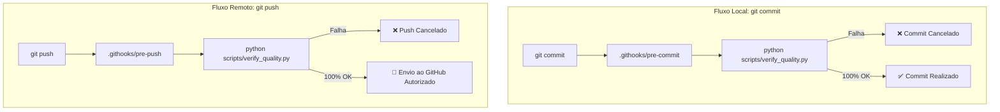

# Sistema Monolítico Full Stack de Previsão de Consumo Elétrico (Zenodo 2025)

[](https://www.python.org/)
[](LICENSE)
[](SECURITY.md)
[](https://github.com/psf/black)
[](https://pycqa.github.io/isort/)
[](https://flake8.pycqa.org/)
[](https://docs.pytest.org/)

Aplicação acadêmica monolítica desenvolvida para a disciplina **PGENE585 – Transição Energética Sustentável e Mercados de Energia**, com foco exclusivo no desafio **Zenodo Smart Building (2025)**.

---

## 1. Visão Geral da Arquitetura

O sistema implementa uma arquitetura **monolítica moderna 100% em Python**, combinando Programação Orientada a Objetos (**POO**), princípios **SOLID**, design limpo (**Clean Code**) e uma interface reativa em **Streamlit + Plotly**.

```
energy-demand-forecast/
├── .githooks/                # Hooks pré-commit e pré-push para garantia de qualidade
├── data/
│   ├── baseline/zenodo/      # Cópia protegida do dataset original oficial
│   ├── db/                   # Persistência JSON (active_config, best_models_registry, experiment_runs, zenodo_forecast_results)
│   └── zenodo/               # Datasets da Competição Zenodo 2025
├── docs/                     # Documentação e enunciado (zenodo.pdf)
├── presentation/             # Apresentação em slides (PPTX e PDF)
├── results/                  # Figuras renderizadas em 300 DPI para publicação
├── rules/                    # Diretrizes obrigatórias de governança para IAs (SOLID, Clean Code, Git)
├── scripts/                  # Scripts utilitários de formatação e verificação de qualidade
├── src/
│   ├── core/                 # Domínio: métricas, diagnóstico, cenários de corte e esquema de Hiperparâmetros/Covariáveis
│   ├── pipelines/            # Carga cross-dataset (dataset_loader), ZenodoPipeline (1h) e CLI CycleManager
│   ├── ui/                   # Dashboard Streamlit (Ponto de Corte + Covariáveis), Laboratório e gráficos Plotly
│   └── utils/                # I/O atômico JSON, banco de experimentos e leitura resiliente
├── tests/                    # Suíte completa de testes unitários e de integração (18 testes)
├── streamlit_app.py          # Ponto de entrada para Streamlit Community Cloud
├── .flake8                   # Configuração do linter estático e complexidade Sonar
├── pyproject.toml            # Configuração unificada do Black, isort e pytest
├── requirements.txt          # Dependências do projeto
├── MEMORY.md                 # Memória persistente de atividades recentes (rolling buffer)
└── README.md                 # Este guia de operação
```

---

## 2. Pipeline Zenodo Smart Building & Banco de Experimentos (`data/db/`)

Todos os resultados do último treino (`zenodo_forecast_results.json`), o estado configurável, o histórico de experimentos e os campeões são persistidos de forma atômica em `data/db/`:

- **Validação Cross-Dataset com Ponto de Corte Temporal (`src/core/forecasting.py` & `src/pipelines/dataset_loader.py`):**
  - Leitores resilientes para `data_v1.0.xlsx` (`8.760 h`), `data_v2.0.xlsx` (`960 h`, normalizando `ºC` e `˚C`) e `data_v4.1..4.3` (`72 h` de previsão climática + consumo real), mantendo horizonte estrito de **`1h` (passo único)** e *warm-up* causal sem vazamento (*data leakage*).
  - **3 Cenários Oficiais no Topo do Painel:** `v1.0 Split Interno (80/20)`, `Treino v1.0 → Teste v2.0` e `Treino v1+v2 → Teste v4 Oficial` (este último restringindo automaticamente atributos compatíveis com `v4`: `time`, `temp_c` e memória `≤ 24 h`).
- **Hiperparâmetros de ML vs. Covariáveis (`src/core/parameter_schema.py`):**
  - _Hiperparâmetros de ML (Configuráveis):_ Engenharia Temporal (`power_lags`, `rolling_mean_windows`, `rolling_std_windows`, `hour_sin/cos`, `hour_raw`, protocolo de corte) e Hiperparâmetros do Algoritmo (`Ridge`, `Random Forest`, `HistGradientBoosting`).
  - _Covariáveis Exógenas (Imutáveis — On/Off):_ temperatura externa (`temp_c`), geração solar FV (`gen_w`) e grandezas elétricas defasadas (`voltage_lag_1`, `amperage_lag_1`); `power (W)` permanece sempre como alvo imutável (`y`).
- **Modelos Avaliados, Campeões por Cenário & Limpeza (`src/core/diagnostics.py`, `src/utils/experiment_db.py`):** `Ridge_Linear`, `Random_Forest` e `Hist_Gradient_Boosting` avaliados em Treino e Teste com **Score Multi-Critério Zenodo (0–100)**, seleção isolada por `evaluation_scenario`, exibição da **`run_XXXX` ativa** no topo da Página 1 e compactação de histórico (`🧹 Limpar Histórico (Manter Só Campeão)`).

---

## 3. Instalação e Configuração

```bash
pip install -r requirements.txt
```

---

## 4. Como Executar a Aplicação

### 4.1. Dashboard Web Interativo (Streamlit)

```bash
python -m streamlit run streamlit_app.py
```

A interface carregará com 2 módulos de navegação:

1. **Previsão de Consumo (Zenodo 2025):** Seletor de cenários no topo (`v1.0`, `v1 → v2`, `v1+v2 → v4`) com indicador da **`run_XXXX` ativa**, gráfico principal no estilo **Ponto de Corte Temporal** (Contexto Pré-Corte à esquerda + previsão `1h` à direita + switches de **Covariáveis** abaixo), tabela Multi-Critério e **Bancada de Pesquisa** em 3 abas (**Diagnóstico**, **Laboratório de Parâmetros** e **Histórico & Comparação** com *backdrop* unificado de processamento e botão `🧹 Limpar Histórico (Manter Só Campeão)`).
2. **Auditoria Técnica (JSON):** Consulte a tabela de campeões por critério (`best_models_registry.json`), o histórico completo (`experiment_runs.json`) e inspecione os JSONs completos do pipeline usando exclusivamente os dados oficiais do desafio.

### 4.2. Executar via Terminal (CLI)

```bash
# Executa o pipeline Zenodo
python -m src.pipelines.cycle_manager --run-all

# Verifica a integridade do JSON gerado
python -m src.pipelines.cycle_manager --check
```

---

## 5. Qualidade de Código, Linting, Formatação e Testes (SonarQube Ready)

O projeto adota uma esteira completa de engenharia de software para garantir conformidade estrita com o **SonarQube**, **PEP 8** e cobertura de **testes automatizados**.

### 5.1. Ferramentas Utilizadas

| Ferramenta   | Propósito Técnico                                                                                                   |
| :----------- | :------------------------------------------------------------------------------------------------------------------ |
| **`black`**  | Formatador determinístico de código (estilo Prettier para Python), configurado para 100 caracteres.                 |
| **`isort`**  | Organizador e ordenador semântico de imports em blocos (built-in, terceiros e locais).                              |
| **`flake8`** | Linter estático que verifica aderência à PEP 8 e penaliza complexidade ciclomática elevada (`max-complexity = 12`). |
| **`pytest`** | Framework de testes unitários (cálculo de métricas) e testes de integração (execução do pipeline).                  |

---

### 5.2. Comandos Disponíveis para o Desenvolvedor

#### 🎨 1. Formatar Código Automaticamente

Aplica o `isort` e o `black` em todos os módulos Python do projeto em um único comando:

```bash
python scripts/format_code.py
```

#### 🔍 2. Verificar Quality Gate Completo (Sem Modificar Arquivos)

Executa a validação de imports, formatação, análise estática e todos os testes:

```bash
python scripts/verify_quality.py
```

#### 🧪 3. Executar Apenas os Testes Automatizados

```bash
python -m pytest tests/ -v
```

#### 📋 4. Executar Apenas o Linter Estático (Flake8)

```bash
python -m flake8 src/ tests/ presentation/ scripts/ streamlit_app.py
```

---

### 5.3. Automação de Qualidade no Git (Pre-Commit & Pre-Push Hooks)

Para garantir que nenhum código com erro de sintaxe, complexidade excessiva ou falha em testes seja gravado ou enviado ao GitHub, configuramos dois **Git Hooks automatizados**:



- **Pre-Commit Hook (`.githooks/pre-commit`):** Executa automaticamente a cada `git commit`, validando `isort`, `black`, `flake8` e `pytest`. Se houver falha, o commit é abortado imediatamente.
- **Pre-Push Hook (`.githooks/pre-push`):** Executa automaticamente a cada `git push`, servindo como segunda barreira de proteção antes do código atingir o repositório remoto no GitHub.
- **Ativação dos Hooks:**
  ```bash
  git config core.hooksPath .githooks
  ```

---

## 6. Governança e Regras para IAs

As diretrizes detalhadas de arquitetura, POO com SOLID, Zero Trash, testes e controle de versão estão formalizadas no diretório [`rules/`](rules/README.md) e no ponto de entrada [`AGENTS.md`](AGENTS.md):

- [`rules/01_ARCHITECTURE_SOLID.md`](rules/01_ARCHITECTURE_SOLID.md): Arquitetura monolítica em camadas e SOLID.
- [`rules/02_CLEAN_CODE_ZERO_TRASH.md`](rules/02_CLEAN_CODE_ZERO_TRASH.md): Clean Code, legibilidade e política de zero resíduos.
- [`rules/03_SONARQUBE_AND_QUALITY.md`](rules/03_SONARQUBE_AND_QUALITY.md): Conformidade SonarQube e complexidade ciclomática.
- [`rules/04_TESTING_STANDARDS.md`](rules/04_TESTING_STANDARDS.md): Testes unitários e de integração obrigatórios.
- [`rules/05_GIT_AND_COMMIT_POLICY.md`](rules/05_GIT_AND_COMMIT_POLICY.md): Conventional Commits e **proibição total de push pela IA**.
- [`rules/06_DOCUMENTATION_EVOLUTION.md`](rules/06_DOCUMENTATION_EVOLUTION.md): **Evolução mandatória do README.md** a cada mudança.
- [`rules/07_AGENT_MEMORY_POLICY.md`](rules/07_AGENT_MEMORY_POLICY.md): **Memória Viva (Living Memory & Rolling Buffer)** via [`MEMORY.md`](MEMORY.md) com atualização mandatória a cada tarefa.

---

## 7. Licença e Autor

- **Licença:** [MIT](LICENSE) © 2026 Aldair da Silva Azevedo.
- **Autor:** **Aldair da Silva Azevedo** ([LinkedIn](https://www.linkedin.com/in/aldair-azevedo/) | [GitHub](https://github.com/AldairAzevedo)).
